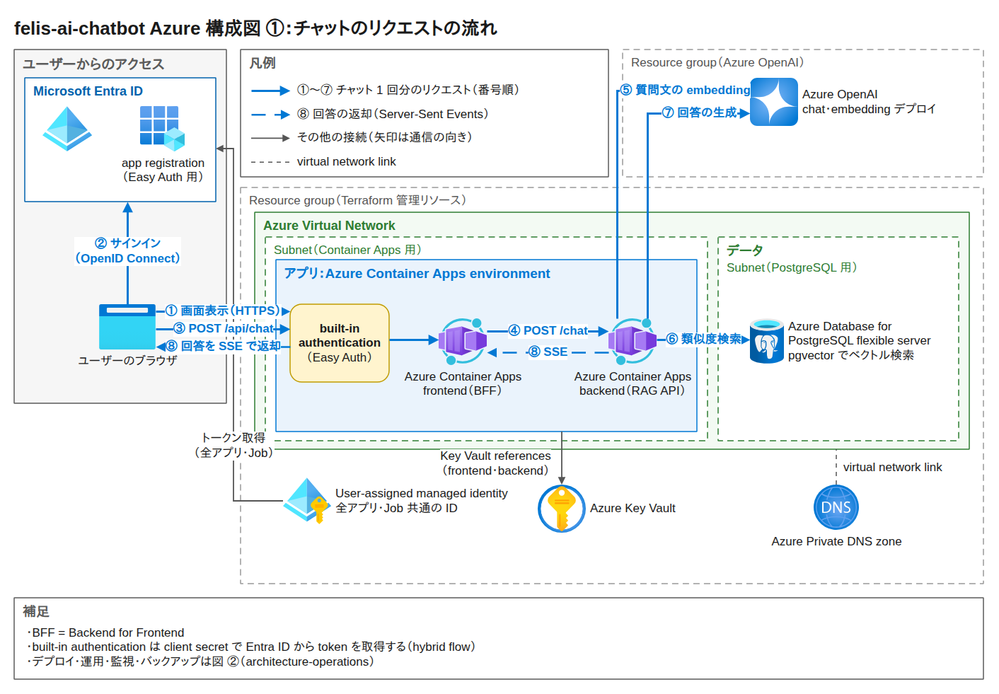
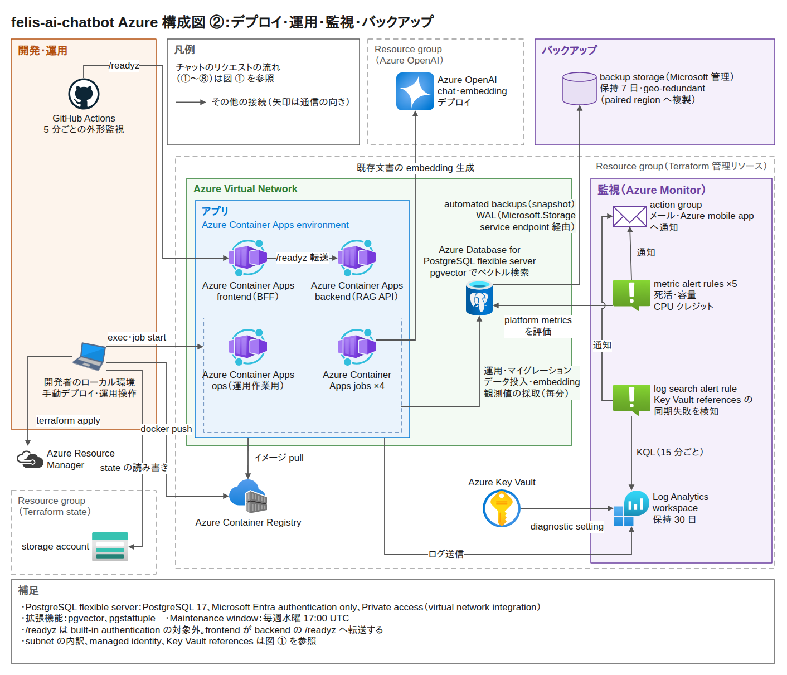

# felis-ai-chatbot

pgvector による RAG chatbot（Next.js + FastAPI + PostgreSQL）。frontend / backend / PostgreSQL と
観測用 Job を Azure 上に Terraform で構築しています（frontend は Easy Auth 付きの Container App、
backend は internal ingress で frontend の BFF 経由でのみ到達可能）。
成果物はアプリではなく、**その PostgreSQL の Backup / PITR / Maintenance / Monitoring / HA を
設定で終わらせずドリルとして実行し、実測値を証跡として残したこと**です。

## 対象ロールと、このリポジトリで示せること

- **対象ロール**: DevOps Engineer / SRE / Platform Engineer / インフラエンジニア
- **基盤**: Terraform で PostgreSQL Flexible Server / Container Apps（frontend / backend / ops の 3 App + Job 4 本）/
  ACR / VNet + Private DNS / Log Analytics / Azure Monitor アラートを管理。DB は private access で、
  運用経路は VNet 内の ops コンテナに一本化
- **可観測性**: `/readyz` の外形監視と、DB 内の観測 3 系列（1 分 / 5 分 / 1 時間）を継続採取。
  これらは operational signal であり、user-facing SLI / SLO の定義と未決定事項は
  [SLO document](./docs/operations/slo/slo-document.md) に分離
- **変更管理**: Issue / Branch / PR / 必須ラベル / CI ガードレール。ルールは
  [CONTRIBUTING.md](./CONTRIBUTING.md)、AI Agent 向けの作業ルールは [CLAUDE.md](./CLAUDE.md)
- **公開している弱点**: 本番運用に足りていないものを理由と追跡先つきで 1 枚に集約
  （[docs/production-readiness.md](./docs/production-readiness.md)）

## 実測値

進行中のプロジェクトです。**未実測を先に並べています。**

| 項目 | 状態 |
| --- | --- |
| 高負荷観測（フェーズ 2） | **未実装** — 負荷生成（churn generator）は Issue #112 / PR #120 で未マージ。フェーズ 1 の毎分 1 行の書き込みは PITR の復旧時点を確定させる recovery marker であり、負荷生成ではありません（[ADR-0021](./docs/adr/0021-heartbeat-table-as-recovery-marker.md)） |
| ベースライン観測（フェーズ 1、72h） | **完了** — 2026-08-23T08:16:19Z 起点の固定 72h 窓。probe 131 点のうち `code=200` が 128 点（97.71%）、レイテンシ中央値 21.5 秒 / p90 24.3 秒 |
| PITR ドリル（実測復元所要区間 / 復元点精度） | **実測済み** — 3 回実施。いずれも移行元のサブスクリプションのサーバーで測った値で、移行先（[ADR-0030](./docs/adr/0030-subscription-migration-and-02-suffix-naming.md)）では未実施。2026-09-04 custom restore ドリル: 実測復元所要区間 6 min 51.155 s / 復元点精度 39.035 s、2026-09-05 fast restore ドリル: 5 min 42.130 s / 0.473 s（[pitr-drill.md](./docs/verification/restore-drill/pitr-drill.md)）。どちらも上限値で、実測復元所要区間はポーリング間隔 15 s を、復元点精度は heartbeat 1 分粒度の標本化誤差を含む。2026-09-12 state verification ドリル（latest restore）は HNSW・identity / sequence・パラメータ・拡張・権限・統計を復元先で検証し、実測復元所要区間は欠測扱い（`state=Ready` 初観測まで 8 min 57.474 s。[2026-09-12-pitr-drill-state-verification.md](./docs/verification/restore-drill/2026-09-12-pitr-drill-state-verification.md)） |
| ゾーン冗長 HA の failover ダウンタイム | **実測済み** — 2026-08-28 実施。外形プローブ（10 秒間隔、誤差 ±20 秒）で planned failover 23.9 秒 / forced failover 30.4 秒（公称 60〜120 秒）。primary の zone は 1 → 2 → 1 と実際に移った。HA 有効化 / 無効化は 10 秒粒度で非 200 ゼロ。DB 約 4 GiB・書き込みは毎分 1 行のみの条件で、PITR の実測復元所要区間とは別物 |
| General Purpose へのスケールのダウンタイム | **実測済み** — 2026-08-28 実施。同じ外形プローブで tier 昇格（B1ms → GP）5 分 30 秒 / tier 復帰（GP → B1ms）7 分 10 秒（公称 regular scaling 2〜10 分。B1ms は near-zero downtime scaling の対象外）。failover より 1 桁大きい |
| 外形監視の実効 coverage | **実測済み** — 固定 72h 窓で scheduled run 131 回 ÷ 名目 cron 機会 864 回 = 15.2%。最大無観測時間 102.8 分 |
| 障害通知の到達 | **実測済み** — probe の run failure から 20 秒後に、GitHub の通知インボックスへ配送記録が生成された（メール受信の実証ではない） |
| autovacuum の自然発火 | **実測済み** — 1 行を毎分 UPDATE するテーブルで 22.6 時間に 26 回（約 52 分周期） |
| private access（VNet 統合）への切替 | **実測済み** — VNet 内経路の `/readyz` 200 と、作業端末からの到達不能を両方確認 |

> PITR の実測値は、目標値と混同しないため RPO / RTO とは呼びません
> （[restore-drill-recovery-objectives.md](./docs/operations/restore-drill-recovery-objectives.md) §6）。
> custom restore / fast restore は n = 1 ずつの観測で、Azure 側の混雑条件も統制していません。
> HA failover の 23.9 秒 / 30.4 秒は HA が有効なときのそのシナリオでの復旧時間であって、
> バックアップからの復旧時間ではありません。
> RTO 目標（3 時間）を実測値をもとに改定するかは未判断です（目標値は同文書 §2 のまま）。

## このプロジェクトの立て付け

実務では DB 運用を担当していません。カタログスペックや手順書の知識ではなく、
**自分で構築して実際に動かした実測値で答えられる状態**を作るために、
Azure 上に PostgreSQL を建てて Backup / PITR / Maintenance / Monitoring / HA を
設計・実行・記録しました。

「実務でやった」とは書きません。立て付けは
「実務では担当していない。だから自分で構築して一通りやった。これがその記録」で固定しています。
勝負どころは追い質問（リストアは試したか / 保持期間はどう決めたか /
メンテナンス中に止まったか / vacuum は見ているか）で、
それに実測で答えるためにこのリポジトリがあります。

## 構成図

図 1 はチャットのリクエストの流れ、図 2 はデプロイ・運用・監視・バックアップです。
編集用の drawio ファイルは各図の下にリンクしています。

編集用: [architecture-request-flow.drawio](./docs/architecture/architecture-request-flow.drawio)

編集用: [architecture-operations.drawio](./docs/architecture/architecture-operations.drawio)

## 実測から出た発見

数値と再現手順の正本は
[docs/verification/observation-phase1/observations.md](./docs/verification/observation-phase1/observations.md) です。

- **SQL は完走しているのに job execution は Failed になる。**
  `replicaTimeout` 55 秒での打ち切りで、exit code すら残りません。
  「job status」と「採取データの完全性」は別物として扱う必要があります
- **`gh run view --log` は failure run に対して 0 バイトを返す**（success では取得できる）。
  可用性 SLI の分子だけが黙って落ちます。REST の job logs 経由なら取得できます
  （抽出は [scripts/collect-probe-records.sh](./scripts/collect-probe-records.sh) に固定しました）
- **可用性 97.71% は「アプリの可用性」ではありません。**
  フェーズ 1 当時は serving が `min_replicas 0` だったため probe は毎回 cold start を起こし、
  この観測値は実質「cold start が curl の `--max-time` 以内に完了する率」です。
  現在の Terraform と Azure runtime は [ADR-0025](./docs/adr/0025-serving-min-replicas-1-for-sli-integrity.md)
  により `min_replicas 1` であり、変更前後は同じ系列として比較できません。
  フェーズ 1 の保全レコードで再計算すると、
  タイムアウトを 30 秒から 25 秒にするだけで 97.71% → 91.60% に落ちます
- **cron `*/5` に対して実際に起動したのは 15.2%。** 起動しなかった 733 機会は success とも
  failure とも言えないため unknown として分母から外しています。72h の稼働率は測れていません

## もっと見る

- [docs/production-readiness.md](./docs/production-readiness.md): 本番運用との差分（理由と追跡先つき）
- [docs/operations/slo/slo-document.md](./docs/operations/slo/slo-document.md): user-facing SLI / SLO、error budget、および review procedure の入口
- [docs/observability/slo/](./docs/observability/slo/README.md): felis 固有の SLI / SLO 実装資料。計測の記録項目・データ形式の仕様案
- [docs/adr/README.md](./docs/adr/README.md): 設計判断（ADR）。撤回した判断も削除せず残しています
- [docs/verification/observation-phase1/observations.md](./docs/verification/observation-phase1/observations.md): フェーズ 1 の実測記録・食い違い・未検証項目
- [docs/verification/failover-drill/observations.md](./docs/verification/failover-drill/observations.md): HA failover / tier 変更ドリルの実測記録（downtime・zone 遷移・公称との照合・限定）
- [docs/operations/credit-window-execution-plan.md](./docs/operations/credit-window-execution-plan.md): 進行中のフェーズ計画（PITR ドリル / メンテナンスドリル / teardown）

## ローカルで動かす

手順は [docs/development/local-setup.md](./docs/development/local-setup.md) にまとめています
（`cp .env.example .env` のあと `docker compose up -d`）。
